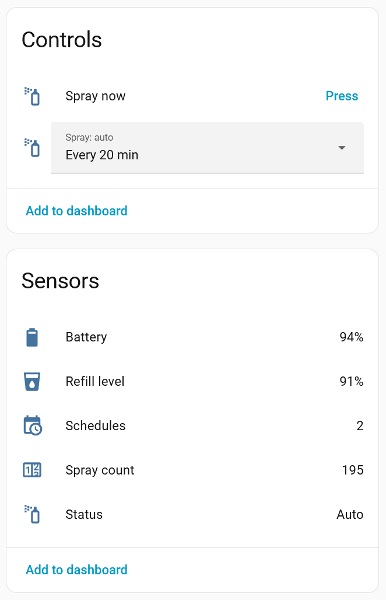
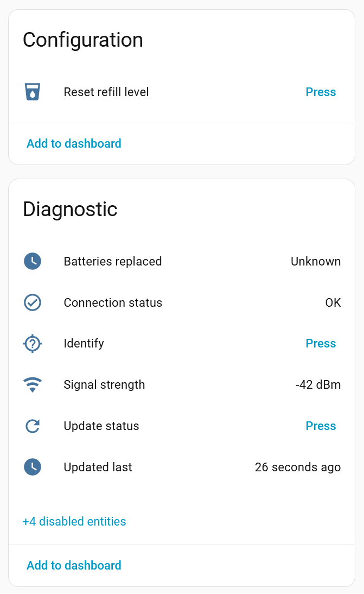
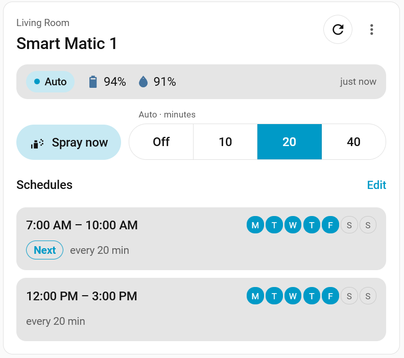
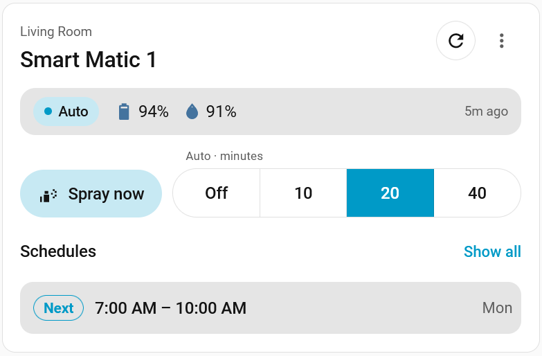

# Godrej Aer Smart Matic Integration for Home Assistant

A custom integration for the Godrej Aer Smart Matic, a battery-powered Bluetooth
(BLE) air freshener. It reads the device's status and controls it
locally over Bluetooth, through an adapter on the Home Assistant host or an
ESPHome Bluetooth proxy. No cloud account is needed.

Forked from [ov1d1u/godrej_aer](https://github.com/ov1d1u/godrej_aer), with
several quality and reliability improvements, plus support for the device's
schedules, actions and other new features. See the
[releases](https://github.com/rgitha/aer_smartmatic/releases) for details.

<p>
  
  
</p>

## Use cases

- Spray when someone enters a room, or before guests arrive.
- Turn auto-spray on while you're home and off when everyone leaves.
- Get notified when the batteries or the refill run low.
- Keep spray schedules on the device, so they run even when Home Assistant
  is down, and edit them from Home Assistant.

## Requirements

- Home Assistant with a Bluetooth adapter on the host, or an ESPHome
  Bluetooth proxy within range of the device.
- An Aer Smart Matic. Tested on firmware 3.0.8-IN.
- No phone connected to the device while Home Assistant uses it.

## Companion card

The [Card for Godrej Aer Smart Matic](https://github.com/rgitha/godrej-aer-card)
shows the status, Spray now, auto-spray and the schedules in one card, and
lets you add and edit schedules from a dashboard. **It is installed
separately**, from its own repository.

<p>
  
  
</p>

## Installation

### HACS

1. In HACS, open the menu and choose **Custom repositories**.
2. Add `https://github.com/rgitha/aer_smartmatic` as an **Integration**.
3. Install **Aer Smart Matic** and restart Home Assistant.

### Manual

Copy `custom_components/aer_smartmatic` into your `config/custom_components`
folder and restart Home Assistant.

## Configuration

Home Assistant discovers devices within range and offers them under
**Settings → Devices & services**; choose **Add** and confirm.

Or, to add one yourself, choose **Add integration → Aer Smart Matic**. Select a discovered
device or enter the device's Bluetooth MAC address manually, e.g. `AA:BB:CC:DD:EE:FF`.

Home Assistant then checks that the device responds and adds it as "Smart
Matic". In the dialog that follows, give it a name (e.g. Smart Matic Hall) and an area.

Setup also checks whether the device firmware supports on-device schedules. The Status sensor's
**has_clock** attribute shows the result. A device that does not support schedules has its
schedule features removed: no Schedules sensor, and the schedule actions are refused.

Use **Reconfigure** on the integration entry to re-run these checks at any time and reconfigure the device.

## Entities

**Controls**
- **Spray now:** sprays once.
- **Spray: auto:** Off, or every 10, 20 or 40 minutes. The `started_by`
  attribute shows what started it: app, schedule or button.
- **Reset refill level:** after replacing the cartridge. The device resets its spray count to zero,
  so Refill level goes back to 100 %.
- **Identify** (diagnostic): lights the device's three interval lights for 3
  seconds. It works only while auto-spray is off and no schedule is running.
- **Update status:** reads the status and schedules now.

**Sensors**
- **Status:** Idle, Auto, Schedule or Disconnected. Its **has_clock**
  attribute shows whether the device keeps time (see Configuration).
- **Battery:** battery percentage, from 3.1 V (100 %)
  down to its 2.4 V cut-off (0 %). The voltage is a diagnostic sensor
  (disabled by default).
- **Refill level** (an estimate from the spray count) and **Spray count**
  (since the last refill reset).
- **Schedules:** the number of schedules on the device. Its attributes list
  them (days, start, end, interval), the one **running** now, and when they
  were **last read**.

**Diagnostic sensors**
- **Connection status:** OK, or Unreachable when the device isn't heard or the
  last command or read failed.
- **Updated last:** when the status was last read.
- **Batteries replaced:** when new batteries were last seen, meaning the
  battery level rose by more than 10 points to 90 % or more. Unknown until
  then.
- **Signal strength:** with the adapter or proxy that received it.
- **Channel: command**, **Channel: reply** and **Connection link:** for
  debugging Bluetooth setup, disabled by default.

**Diagnostics download:** on the device page, ⋮ → Download diagnostics. The
address and name are redacted.

## Schedules

The device runs up to 10 schedules on its own, even when Home Assistant is
down. Each has days, a start and end time, and an interval of 10, 20 or 40
minutes.

- An end at or before the start means the next day, so a window can run past
  midnight, up to 24 hours.
- Saving schedules restarts a schedule that is running, since the device replaces the
  whole list.

The integration periodically syncs the device's clock with Home Assistant's. Edit schedules with the companion card or the
actions below.

## Actions

### `aer_smartmatic.update_status`

Reads the status and schedules now. Target one or more devices or entities,
or leave the target out to update every device. Unlike
`homeassistant.update_entity`, which does the same read, it reports a failure
("Couldn't reach …").

```yaml
action: aer_smartmatic.update_status
target:
  device_id: <your Smart Matic device>
```

### Schedule actions

All target one or more devices.

| Action | Fields |
|---|---|
| `aer_smartmatic.set_schedules` | `schedules`: the whole list. Optional `expected`: the list you started from; nothing is written if the device's list changed meanwhile. |
| `aer_smartmatic.add_schedule` | `days`, `start`, `end`, `interval` |
| `aer_smartmatic.remove_schedule` | `number`: its number in the Schedules sensor's list |
| `aer_smartmatic.clear_schedules` | none |
| `aer_smartmatic.stop_schedule` | `schedule`: `current`, `all` or a number. Skips a running schedule; a number that isn't running is ignored. |

Every save is read back, and an error is shown if the device didn't keep it.

```yaml
action: aer_smartmatic.add_schedule
target:
  device_id: <your Smart Matic device>
data:
  days: [mon, tue, wed, thu, fri]
  start: "07:00"
  end: "10:00"
  interval: 20
```

## Examples

Spray when motion is detected in the hall, at most once every 15 minutes:

```yaml
automation:
  - alias: Hall freshener on motion
    mode: single
    triggers:
      - trigger: state
        entity_id: binary_sensor.hall_motion
        to: "on"
    actions:
      - action: button.press
        target:
          entity_id: button.hall_spray_now
      - delay: "00:15:00"
```

Notify when the battery is low:

```yaml
automation:
  - alias: Hall freshener battery low
    triggers:
      - trigger: numeric_state
        entity_id: sensor.hall_battery
        below: 15
    actions:
      - action: notify.notify
        data:
          message: "Replace the batteries in the hall freshener."
```

## How it stays up to date

The device doesn't report changes by itself, so the integration reads its
status about once an hour, after every command, around each schedule's start
and end, and when you press **Update status**. Changes made with the device's
button or a phone show up at the next read.

The device runs one command at a time. A command made while another is in
progress waits its turn; if it can't start within 5 seconds, you'll see
"The device is busy with another command. Try again."

When Home Assistant hasn't heard the device for a few minutes (typically 3 to
8), Connection status turns Unreachable, Status shows Disconnected and the
other entities become unavailable. They return, with a fresh status read, as
soon as the device is heard again.

## Removal

1. Go to **Settings → Devices & services → Aer Smart Matic**.
2. Open the device entry's ⋮ menu and choose **Delete**.
3. To remove the integration completely, uninstall it in HACS (or delete
   `custom_components/aer_smartmatic`) and restart Home Assistant.

The device keeps its auto-spray setting and schedules, and runs on its own.

## Known limitations

- **Range:** Keep it within range of an adapter or proxy.
- **One connection at a time:** while there is another connection to the device, Home
  Assistant can't reach it as the device supports only one connection at a time.
- **Status isn't live:** changes made on the device or a phone show up at the
  next status update.
- **Low batteries:** below 2.4 V the device still acknowledges sprays without
  spraying. Spray now and Spray: auto then show "Batteries are too low to
  spray".
- **Refill level** is an estimate from the spray count, not a measurement.
- **Schedules from other tools:** a phone app that writes the device's
  schedules may not read them first, so a change made there can replace the
  ones set here.
- **Skipping ahead:** only a schedule that is running can be skipped; a later
  run can't be skipped in advance.

## Troubleshooting

- **Device not found, or "The device didn't respond":** check that it has
  batteries, move it closer to an adapter or proxy, disconnect any phone
  connected to it and try again.
- **Unreachable or Disconnected:** as above. **Signal strength** shows how well
  the adapter or proxy heard the device.
- **"The device is busy with another command":** another command or read is
  still running. Try again in a moment.
- **A command shows an error:** the device didn't confirm it within 5 seconds.
  The status is read again afterwards, so the entities show what the device is
  actually doing.
- **No Schedules sensor, or schedule actions are refused:** the device's
  clock didn't work at setup or the particular device firmware has no schedules support (Status's **has_clock** is false). Use
  **Reconfigure** to check again, if the device supports schedules.
- **The proxy seems stuck:** an ESPHome Bluetooth proxy can get into a state
  where it still hears the device but can't connect to it. The log then warns
  that the device "is heard but can't be connected to". Restart the proxy.
- **Reporting a problem:** attach the diagnostics download, and a debug log
  (on the integration page, ⋮ → Enable debug logging).

## Development

The device library has a test suite that runs without Home Assistant:

```
pip install pytest pytest-asyncio bleak bleak-retry-connector
pytest
```

The config flow, entities and entry setup are tested against Home Assistant
itself, in a separate environment:

```
pip install pytest-homeassistant-custom-component
pytest tests_ha
```

The code is fully typed; check it in the Home Assistant environment with:

```
pip install mypy
mypy --strict custom_components/aer_smartmatic
```

## License

Apache License 2.0.

## Contributions

Bug reports and suggestions are welcome as GitHub issues, and fixes as pull
requests.

## Disclaimer

This project is not associated with Godrej Aer. All rights regarding the
devices are reserved to Godrej Aer. It is not officially supported. Use at your own risk.
